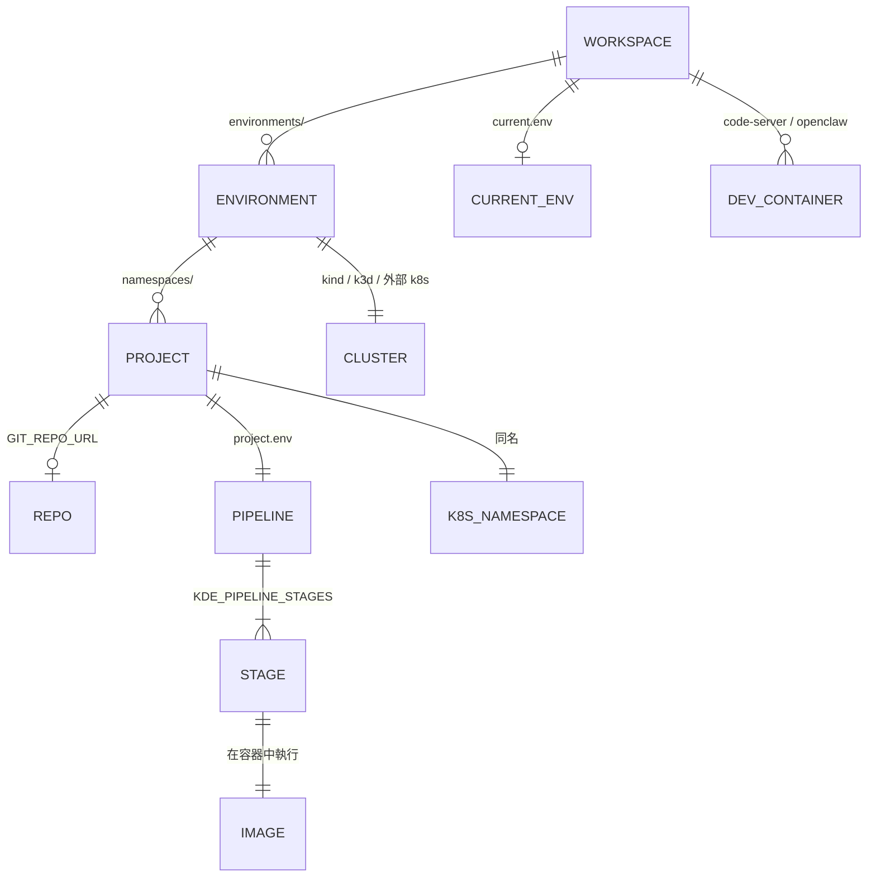

# KDE-CLI 需求模型

本目錄是從現有程式碼**反推**出來的需求模型，描述 `kde` 這個 CLI 目前實際提供的能力、
它服務的角色，以及它遵守的約束。它不是設計提案，也不是使用手冊（使用手冊在 `docs/core/`）。

- 分析基準：commit `d868ef9`（2026-09-05），`KDE_VERSION=v1.0.0-rc.6`
- 分析日期：2026-11-17
- 範圍：整個 CLI（`kde.sh` 與 `scripts/` 全部 27 個頂層命令）。
  `dockerfiles/` 的映像建置流程與 `install.sh` / `release.sh` 只在影響 CLI 行為時提及。

## 怎麼讀這份文件

| 你想做的事 | 從這裡開始 |
|---|---|
| 了解系統在做什麼、給誰用 | 本檔的「角色」與「領域模型」 |
| 查某個命令的完整行為（含出錯時） | [use case 索引](#use-case-索引) → 對應檔案 |
| 重寫或移植 | 各 use case 檔 + [08 非功能需求與約束](08-non-functional.md) |
| 修文件或修 bug | [09 落差清單](09-gaps.md) |
| 排工作優先順序 | 每個 use case 開頭的 user story + [09 待確認事項](09-gaps.md#待確認事項) |

## 方法與證據

文件可能過時，所以需求是依下列順序採信的。每條需求都標了出處，可以回頭查證。

| 順位 | 來源 | 用途 |
|---|---|---|
| 1 | 程式碼（`kde.sh`、`scripts/`） | 系統實際做的事：流程、旗標、錯誤分支 |
| 2 | 測試（`test/`，23 支） | 被明確固定下來的行為 |
| 3 | 程式碼註解與 git 歷史（543 個 commit） | 「為什麼」：動機、踩過的坑、刻意的取捨 |
| 4 | `docs/`、`README`、`TODO.md`、skill | 使用者目標與工作流程；與程式碼矛盾時不採信，記入落差清單 |

### 需求狀態標記

| 標記 | 意義 |
|---|---|
| ✅ 已確認 | 程式碼與文件一致，或有測試固定 |
| 📄 未文件化 | 只存在於程式碼 |
| ⚠️ 有落差 | 程式碼與文件（或 help、註解）矛盾，或宣稱的行為實際不成立。細節見 [09](09-gaps.md) |
| ❓ 待確認 | 無法從程式碼判斷是刻意的需求還是意外的行為 |

### 這份模型的限制

- **程式碼只說明「現在做了什麼」**。刻意的需求和意外的行為（或 bug）在程式碼裡長得一樣。
  凡是分不出來的，都列在 [09 待確認事項](09-gaps.md#待確認事項)，沒有自行判定。
- **大部分行為是讀程式碼得出的，沒有實際執行**。真正啟動叢集需要 Docker 與網路，
  不在這次分析的範圍。有實際執行驗證的項目在落差清單裡逐條標明。
- 動機（user story 的「以便…」）在程式碼註解或 commit 有寫時直接引用；
  沒寫的是依文件與上下文推定，以「（推定）」標示。

## 角色

| 角色 | 目標 | 主要證據 |
|---|---|---|
| **開發者** | 在本機快速得到一個可用的 K8s 環境，邊改程式邊驗證，不必在主機裝一堆工具 | `docs/principle.md` 目標受眾；互動式選單遍布各命令 |
| **DevOps / SRE** | 定義並版控「專案 → 環境」的交付流程，在本機重現與除錯 CI/CD | pipeline 引擎；`--shell` 除錯模式；外部 K8s 支援 |
| **團隊（Organization）** | 讓成員共用同一份 workspace 設定，新人一鍵建立環境 | 版控檔與本機檔的分離（`kde.env` vs `.env`）；`kde projects fetch` |
| **AI agent** | 以非互動方式操作 `kde`（在 code-server、OpenClaw 容器內，或主機上的 Claude Code） | `--no-tty`、`--command`；`KDE_PATH` 帶入；`kde claude-skill`；2026-04 之後的 commit 幾乎都為此而生 |
| **CI / 腳本** | 在沒有 TTY 的環境執行 pipeline，並以 stdout 取得資料 | `--no-tty`；`kde status json`；`kde openclaw token` |

QA 在 `docs/principle.md` 被列為受眾，但程式碼中沒有專屬於 QA 的能力，
其需求（快速建立測試環境）已被「開發者」涵蓋。

**AI agent 是後來才加入的角色**。CLI 原本以「缺參數就跳互動選單」為核心設計
（`docs/principle.md`：「自動化與互動式混合」），2026-04 起才逐一補上非互動路徑。
這個轉換尚未完成，是目前最主要的需求張力，見 [NFR-02](08-non-functional.md#nfr-02-非互動可操作性)。

## 領域模型



| 概念 | 定義 | 在檔案系統上 |
|---|---|---|
| **Workspace** | 一組環境與專案的根目錄，可整個放進 git 給團隊共用 | 含 `kde.env` 的目錄 |
| **Environment** | 一個 K8s 叢集加上它的設定。類型為 `kind`、`k3d`（本機建立）或 `k8s`（連到既有叢集） | `environments/<env>/`，以 `k8s.env` 存在與否判定環境是否存在 |
| **當前環境** | 未指定環境名稱時命令作用的對象 | `current.env` 的 `CUR_ENV` |
| **Project** | 一個要部署到環境的應用，與一個 K8s namespace 同名 | `environments/<env>/namespaces/<project>/` |
| **專案集合（projects）** | 一個環境下所有專案的集合，可整包來自一個 git repo | `environments/<env>/namespaces/` |
| **Pipeline** | 專案的交付流程，由有序的 stage 組成 | `project.env` 的 `KDE_PIPELINE_*` |
| **Stage** | 在指定映像的容器中執行的一支腳本 | `<project>/<stage>.sh` |
| **開發容器 / 部署容器** | 以 `DEVELOP_IMAGE` / `DEPLOY_IMAGE` 啟動、掛載專案目錄的工作容器 | 無（用完即丟） |

兩個容易誤解的地方：

- **專案目錄同時是 K8s 的儲存區**。kind/k3d 把 `namespaces/` 掛成 local-path-provisioner 的根目錄，
  PVC 的路徑是 `<namespace>/<pvc 名稱>`。所以專案的原始碼可以直接被 Pod 掛載，這就是 hot reload 的機制。
- **環境停止後叢集就不存在了**。`kde stop` 會刪除叢集容器；能保留下來的只有檔案系統上的東西
  （設定、PKI、`namespaces/`）。重新 `start` 是重建叢集，再跑一次預設服務安裝與 `init.sh`。

### 設定的分層

後載入的覆寫先載入的。「版控」欄是設計意圖：版控檔隨 workspace 同步給所有人，本機檔只屬於這台機器。

| 順序 | 檔案 | 版控 | 內容 |
|---|---|---|---|
| 1 | `kde.env` | 是 | 工具映像版本、`KDE_DEBUG`、`ENABLE_K9S` 等 |
| 2 | `environments/<env>/k8s.env` | 是 | `ENV_NAME`、`ENV_TYPE`、`K8S_CONTAINER_NAME`、`DOCKER_NETWORK`、`STORAGE_CLASS` |
| 3 | `environments/<env>/.env` | 否 | `VOLUMES_PATH`、`K8S_API_SERVER_PORT`、`K8S_INGRESS_NGINX_PORT` |
| 4 | `namespaces/<project>/project.env` | 是 | repo、映像、pipeline 設定（執行前經 `envsubst` 展開） |
| 5 | `namespaces/<project>/.env` | 否 | 專案的本機覆寫、機密 |
| 6 | `namespaces/<project>/.pipeline.env` | 否 | stage 之間傳遞的變數，每次 pipeline 開始時清空 |

另有不在這條鏈上的本機狀態：`current.env`、`ngrok.env`、`.cloudflared/`、`.code-server/<name>/`、
`.openclaw-home/`、`.openclaw-backups/`、`.openclaw-image`。

## Use case 索引

| 檔案 | 範圍 | Use case |
|---|---|---|
| [01-workspace.md](01-workspace.md) | workspace 與主機整合 | UC-WS-01 – 09 |
| [02-environment.md](02-environment.md) | 環境生命週期 | UC-ENV-01 – 10 |
| [03-project.md](03-project.md) | 專案與專案集合 | UC-PRJ-01 – 16 |
| [04-pipeline.md](04-pipeline.md) | CI/CD pipeline | UC-PIPE-01 – 08 |
| [05-cluster-access.md](05-cluster-access.md) | 觀察與進入叢集 | UC-ACC-01 – 06 |
| [06-connectivity.md](06-connectivity.md) | 對外連線與流量攔截 | UC-NET-01 – 03 |
| [07-dev-containers.md](07-dev-containers.md) | code-server 與 OpenClaw | UC-DEV-01 – 12 |
| [08-non-functional.md](08-non-functional.md) | 非功能需求與約束 | NFR-01 – 14、CON-01 – 06 |
| [09-gaps.md](09-gaps.md) | 落差清單與待確認事項 | GAP-01 – 27 |

### Use case 的格式

```
### UC-XXX-nn 名稱
狀態
> 身為<角色>，我想要<目標>，以便<動機>。        ← user story
命令 / 前置條件 / 主要流程 / 替代流程 / 例外流程
出處：程式碼位置            測試：對應的測試檔
```

行為單純的命令以表格列出，不展開成完整格式。
